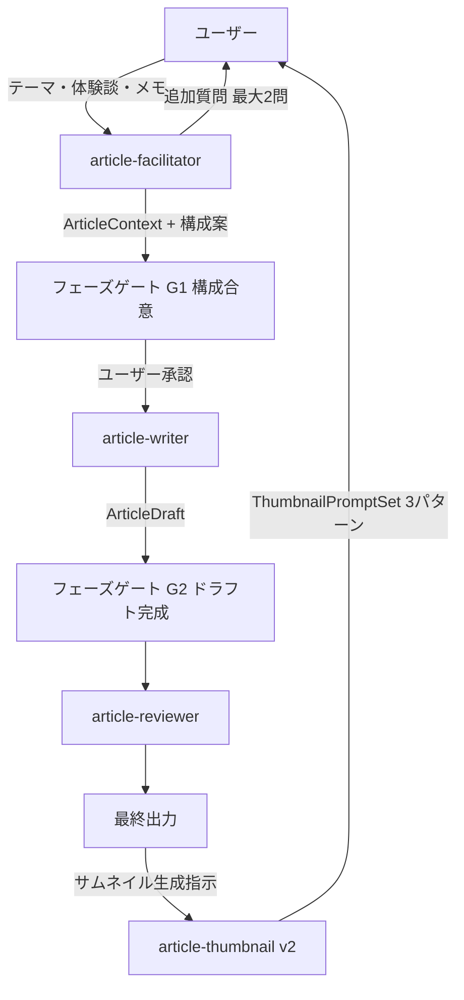
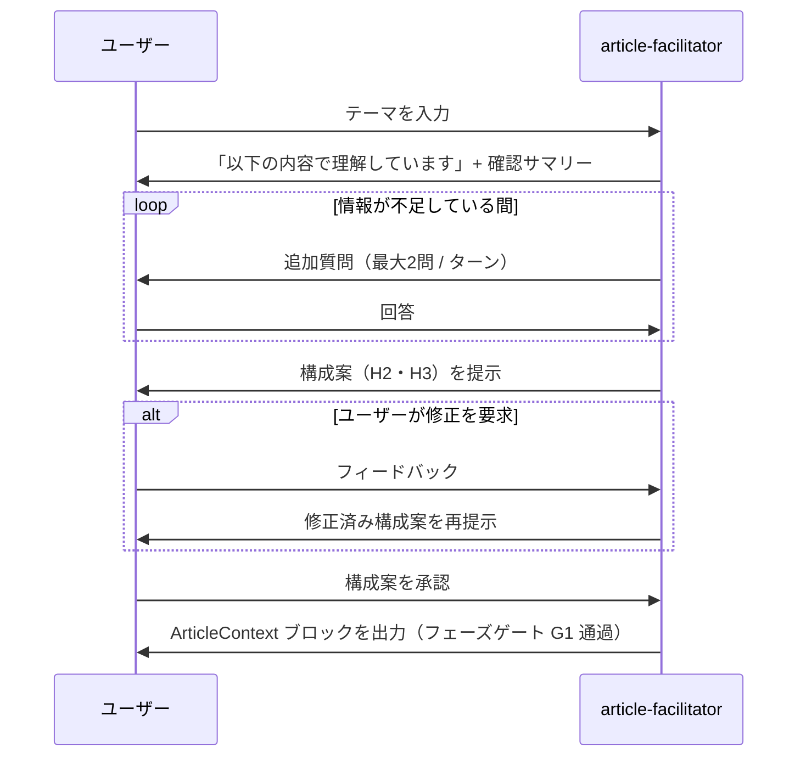
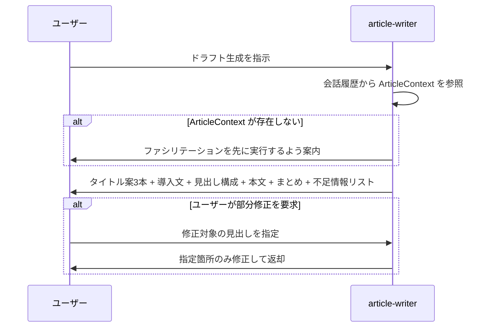
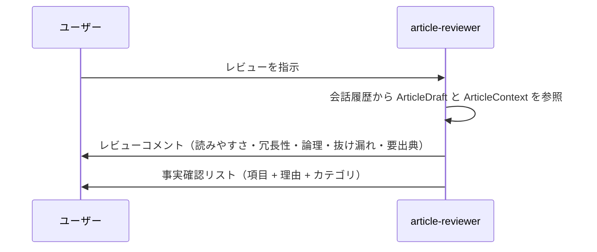
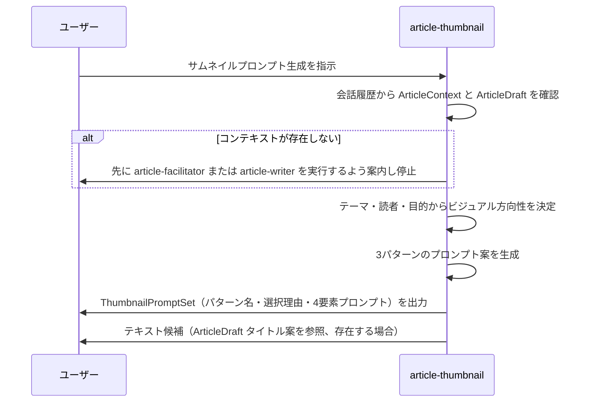

# 設計ドキュメント: article-agent

## Overview

Article Agent はユーザーとの対話を通じてノウハウ解説記事を生成する Claude Code Skills ベースのエージェントシステムである。ユーザーはテーマや体験談を提供するだけで、3スキルがパイプラインとして協調し、企画・構成・執筆・レビューをサポートする。

**Purpose**: 「テーマはあるが何から書けばよいか分からない」ユーザーに対して、会話で考えを整理しながら修正しやすい記事ドラフトと品質チェックリストを提供する。

**Users**: ノウハウ解説記事を書くコンテンツクリエイター・知識共有者が、会話型インターフェースを通じて記事制作の全フローを実行する。

**Impact**: 空白ページへの恐怖（writer's block）とドラフトの品質ばらつきを解消し、記事化のサイクルタイムを短縮する。

### Goals

- 会話によるテーマ整理と構成案合意を実現する（要件 1・2）
- 合意構成から一貫品質の本文ドラフトを生成する（要件 3）
- レビューと事実確認リストによる公開前品質チェックを効率化する（要件 4）
- すべての出力を Markdown で提供し、外部ツールへの転用を容易にする（要件 5）
- 記事内容に基づいた AI 画像生成プロンプト（Nanobanana向け）をバリエーション付きで提供する（要件 6、v2）

### Non-Goals（スコープ外）

- 外部 Web 調査の自動実行（要件 7.1）
- 挿絵の画像生成（要件 7.2）
- CMS への自動投稿（要件 7.3）
- 事実の正確性の保証（要件 7.4）
- ノウハウ解説記事以外のジャンル対応（要件 7.5）

---

## Requirements Traceability

| 要件 | 概要 | 担当コンポーネント | インターフェース | フロー |
|------|------|------------------|----------------|------|
| 1.1–1.6 | 対話による情報収集と論点整理 | article-facilitator | FacilitatorService | 会話フロー F1 |
| 2.1–2.5 | 構成案の提示と合意 | article-facilitator | FacilitatorService | 会話フロー F1、フェーズゲート G1 |
| 3.1–3.7 | 本文ドラフト生成 | article-writer | WriterService | ドラフト生成フロー F2 |
| 4.1–4.5 | レビューと品質保証 | article-reviewer | ReviewerService | レビューフロー F3 |
| 5.1–5.5 | 出力形式と非機能要件 | 全スキル共通 | Markdown 出力規約 | — |
| 6.1–6.8 | サムネイル画像生成プロンプト作成（v2） | article-thumbnail | ThumbnailService | サムネイル生成フロー F4 |
| 7.1–7.5 | スコープ外（Non-Goals） | — | — | — |

---

## Architecture

### Architecture Pattern & Boundary Map

採択パターン: **パイプライン with フェーズゲート**（詳細は `research.md` の Architecture Pattern Evaluation 参照）

- 3スキルは独立したスコープを持ち、会話コンテキストを通じて ArticleContext を共有する
- フェーズゲート G1（構成合意）・G2（ドラフト完成）が次フェーズへの移行を制御する
- ToBe の 7役構成へは、パイプラインに新スキルを追加する形で拡張可能



**アーキテクチャ統合:**
- 選択パターン: パイプライン with フェーズゲート — ToBe 拡張性と v1 の実装シンプルさの両立
- 境界: 各スキルは独立した Claude Code Skill として実装し、責務が重複しない
- 既存パターン: Claude Code Skills（SKILL.md）の標準慣行に準拠
- 新コンポーネントの根拠: 3スキル分離により要件 2.5 のフェーズゲートを自然に実現
- v2 拡張: `article-thumbnail` はパイプライン終端の独立スキルとして追加。既存スキルへの変更は不要。ArticleContext / ArticleDraft を読み込み専用で参照する

### Technology Stack

| レイヤー | 選択 / バージョン | 役割 | 備考 |
|---------|----------------|------|------|
| スキル定義 | Claude Code Skills（SKILL.md） | 各エージェント役割の定義と指示 | プロジェクト単位 `.claude/skills/` |
| 状態共有 | Markdown ブロック（会話埋め込み） | ArticleContext の受け渡し | DB 不要、会話履歴が共有メモリ |
| 出力形式 | Markdown | 記事ドラフト・レビュー結果の表現 | Notion / CMS / GitHub 互換 |
| サポートスクリプト | Node.js / Python（オプション） | テンプレート処理・フォーマット整形・評価 | v1 では必須ではない |

---

## System Flows

### F1: 会話フロー（article-facilitator）



**フロー上の重要判断:**
- 情報収集ループは「テーマ・読者・目的」が確定するまで継続する（要件 1.2）
- 1ターンの質問上限は2つ（要件 1.3）— 認知負荷を抑えるための制約
- 構成案は合意なしにドラフト生成フェーズへ進まない（要件 2.5）

### F2: ドラフト生成フロー（article-writer）



### F3: レビューフロー（article-reviewer）



### F4: サムネイル生成フロー（article-thumbnail、v2）



**フロー上の重要判断:**
- コンテキスト参照優先度: ArticleDraft > ArticleContext（両方存在する場合は ArticleDraft を優先）
- テキスト候補は ArticleDraft が存在する場合のみ提案する（要件 6.8）
- プロンプトはツール依存（Nanobanana）の自然言語記述形式とする（要件 6.7）— 詳細は `research.md` Open Questions 参照

---

## Components and Interfaces

### コンポーネント一覧

| コンポーネント | ドメイン / レイヤー | 意図 | 要件カバレッジ | 主要依存 | コントラクト |
|-------------|-----------------|------|--------------|---------|------------|
| article-facilitator | 企画・構成レイヤー | 対話で情報収集し ArticleContext を確定する | 1.1–1.6, 2.1–2.5 | 会話コンテキスト（P0） | Service, State |
| article-writer | 執筆レイヤー | ArticleContext から ArticleDraft を生成する | 3.1–3.7, 5.1–5.5 | article-facilitator 出力 ArticleContext（P0） | Service, State |
| article-reviewer | 品質保証レイヤー | ArticleDraft をレビューし ReviewResult を生成する | 4.1–4.5 | article-writer 出力 ArticleDraft（P0）, ArticleContext（P1） | Service |
| article-thumbnail（v2） | サムネイル生成レイヤー | ArticleContext / ArticleDraft を参照し Nanobanana 向けプロンプトをバリエーション付きで生成する | 6.1–6.8 | ArticleContext（P0）, ArticleDraft（P1） | Service |

---

### 企画・構成レイヤー

#### article-facilitator

| フィールド | 詳細 |
|----------|------|
| Intent | ユーザーとの対話を通じてテーマ・読者・目的・構成を確定し、ArticleContext ブロックを出力する |
| Requirements | 1.1, 1.2, 1.3, 1.4, 1.5, 1.6, 2.1, 2.2, 2.3, 2.4, 2.5 |

**Responsibilities & Constraints**

- テーマ・読者・目的の3要素が揃うまで情報収集を継続する（要件 1.2）
- 1ターンの質問数を最大2つに制限する（要件 1.3）
- 構成案の提示前に収集情報サマリーを確認として示す（要件 2.2）
- 構成合意（フェーズゲート G1）が取れるまでドラフト生成フェーズに移行しない（要件 2.5）
- 推測で補った情報は「〇〇と理解しましたが、正しいですか？」形式で確認する（要件 1.6）

**Dependencies**

- Inbound: ユーザー入力（テーマ・体験談・メモ・文体指定） — 会話コンテキスト（P0）
- Outbound: ArticleContext Markdown ブロック → article-writer（P0）

**Contracts**: Service [x] / State [x]

##### Service Interface

```typescript
interface FacilitatorService {
  /**
   * ユーザー入力を受け取り、情報収集・論点整理・構成案提示を行う。
   * 構成合意完了時に ArticleContext を確定して返す。
   */
  facilitate(userInput: string, sessionHistory: ConversationTurn[]): FacilitatorOutput;
}

interface FacilitatorOutput {
  responseMessage: string;          // ユーザーへの返答（質問 or 構成案 or 確認メッセージ）
  articleContext?: ArticleContext;   // 構成合意完了時のみ設定される
  phase: 'collecting' | 'proposing_outline' | 'confirmed';
}
```

- Preconditions: ユーザーが記事テーマに関する何らかの入力を提供している
- Postconditions: `phase === 'confirmed'` のとき `articleContext` が設定されている
- Invariants: `phase !== 'confirmed'` の間、`articleContext` は null

##### State Management

- State model: `phase`（collecting → proposing_outline → confirmed）
- Persistence: 会話履歴に ArticleContext Markdown ブロックを出力することで暗黙的に永続化
- Concurrency strategy: 単一会話セッション内での逐次処理のみ

**Implementation Notes**

- Integration: SKILL.md の `description` に「記事テーマが提示されたとき、または記事の企画・構成を整理したいとき」と明記して自動起動を設定する
- Validation: 構成案確認後に「以下の ArticleContext を確認してください」というブロックを出力し、ユーザーの承認コメントをフェーズゲート通過の条件とする
- Risks: description の記述が曖昧だと他の記事作業中に誤起動する可能性がある

---

### 執筆レイヤー

#### article-writer

| フィールド | 詳細 |
|----------|------|
| Intent | 確定した ArticleContext に基づいて修正しやすい ArticleDraft を生成する |
| Requirements | 3.1, 3.2, 3.3, 3.4, 3.5, 3.6, 3.7, 5.1, 5.2, 5.3, 5.4, 5.5 |

**Responsibilities & Constraints**

- 会話履歴から最後の ArticleContext ブロックを参照して生成を開始する（要件 3.1）
- ArticleContext が存在しない場合は先にファシリテーションを実行するよう案内し、ドラフト生成を中止する（フェーズゲート G1 の後段チェック）
- 推測で補った箇所に「（確認要）」マーカーを付与する（要件 3.4）
- ユーザー提供の一次情報と一般論を明示的に区別する（要件 3.3）
- 部分修正要求に対して全体再生成ではなく指定箇所のみ修正する（要件 3.6）
- 長文生成前に構成確認を挟む（要件 5.4）

**Dependencies**

- Inbound: ArticleContext Markdown ブロック（会話履歴） — article-facilitator 出力（P0）
- Outbound: ArticleDraft Markdown — article-reviewer（P1）
- External: article-writer/template.md — 出力構造テンプレート（P1）

**Contracts**: Service [x] / State [x]

##### Service Interface

```typescript
interface WriterService {
  /**
   * ArticleContext を読み込み、完全な ArticleDraft を生成して返す。
   * ArticleContext が未確定の場合は FacilitatorService の実行を促す。
   */
  generateDraft(context: ArticleContext): WriterOutput;

  /**
   * ドラフトの特定セクションのみを修正する。
   * 他のセクションは変更しない。
   */
  reviseSection(draft: ArticleDraft, targetSection: string, feedback: string): ArticleDraft;
}

interface WriterOutput {
  draft: ArticleDraft;
  confirmationMessage: string;  // 構成確認メッセージ（生成前に提示）
}
```

- Preconditions: `ArticleContext.confirmedAt` が設定されており、`outline` に1つ以上のセクションが存在する
- Postconditions: `ArticleDraft` の `body` が Markdown 形式で出力される
- Invariants: `missingInfoList` は常に出力に含まれる（空配列も含む）

##### State Management

- State model: ArticleContext（読み込み専用） → ArticleDraft（生成・更新可能）
- Persistence: ArticleDraft は会話に出力されることで暗黙的に保持
- Concurrency strategy: 単一会話セッション内での逐次処理のみ

**Implementation Notes**

- Integration: `template.md` で出力フォーマットを厳格に定義し、品質のばらつきを抑制する
- Validation: 生成前に「以下の構成でドラフトを生成します」と確認メッセージを出力してから本文生成を開始する（要件 5.4）
- Risks: ArticleContext の参照漏れによるコンテキストドリフト → SKILL.md に「会話内の最後の `## ArticleContext` セクションを必ず参照」と明記する

---

### 品質保証レイヤー

#### article-reviewer

| フィールド | 詳細 |
|----------|------|
| Intent | ArticleDraft の品質をチェックし、レビューコメントと事実確認リストを生成する（ドラフトは変更しない） |
| Requirements | 4.1, 4.2, 4.3, 4.4, 4.5 |

**Responsibilities & Constraints**

- ArticleDraft に対してレビューコメントのみを提示する（read-only ルール）
- 事実確認が必要な箇所を一覧化し、各項目に理由を添える（要件 4.2, 4.3）
- 根拠不明の断言を「要出典」としてレビューコメントに記録する（要件 4.4）
- レビュー結果は ArticleDraft と分離した形式で出力する（要件 4.5）

**Dependencies**

- Inbound: ArticleDraft Markdown（会話履歴） — article-writer 出力（P0）
- Inbound: ArticleContext Markdown（会話履歴） — article-facilitator 出力（P1）
- External: article-reviewer/checklist.md — レビュー観点チェックリスト（P1）

**Contracts**: Service [x]

##### Service Interface

```typescript
interface ReviewerService {
  /**
   * ArticleDraft をレビューし、コメントと事実確認リストを返す。
   * ArticleDraft は変更しない（read-only）。
   */
  review(draft: ArticleDraft, context: ArticleContext): ReviewResult;
}
```

- Preconditions: ArticleDraft が会話履歴に存在する
- Postconditions: `ReviewResult.comments` と `ReviewResult.factCheckItems` の両方が出力される
- Invariants: reviewer は ArticleDraft の本文を直接書き換えない

**Implementation Notes**

- Integration: `checklist.md` で「読みやすさ・冗長表現・論理の飛躍・抜け漏れ・要出典」の5観点をチェックリストとして定義する
- Validation: レビュー開始時に「ArticleDraft のレビューを開始します（ドラフトは変更しません）」と宣言する
- Risks: reviewer が本文の一部を書き直してしまう越権行為 → SKILL.md と checklist.md 両方に read-only ルールを明記する

---

### サムネイル生成レイヤー

#### article-thumbnail（v2）

| フィールド | 詳細 |
|----------|------|
| Intent | ArticleContext と ArticleDraft を読み込み、Nanobanana 向けサムネイル画像生成プロンプトを3パターン生成する |
| Requirements | 6.1, 6.2, 6.3, 6.4, 6.5, 6.6, 6.7, 6.8 |

**Responsibilities & Constraints**

- 起動時に会話履歴から ArticleContext または ArticleDraft の存在を確認する（要件 6.1）
- いずれも存在しない場合は停止し、前工程スキルの実行を案内する（要件 6.2）
- プロンプトはビジュアルイメージ・テキストレイアウト・カラートーン・構図余白の4要素を必ず含める（要件 6.3）
- ArticleContext のテーマ・読者・目的を反映したビジュアル方向性を採用する（要件 6.4）
- 3パターン以上のバリエーションを生成し、各パターンに異なるビジュアルコンセプトを持たせる（要件 6.5）
- 各パターンにコンセプト名と選択理由を付与する（要件 6.6）
- 出力は Nanobanana が解釈可能な自然言語記述形式とする（要件 6.7）
- ArticleDraft が存在する場合、タイトル案を参照してテキスト候補を提案する（要件 6.8）
- ArticleDraft・ArticleContext を変更しない（read-only 参照）

**Dependencies**

- Inbound: ArticleContext Markdown ブロック（会話履歴） — article-facilitator 出力（P0）
- Inbound: ArticleDraft Markdown（会話履歴） — article-writer 出力（P1、存在する場合）
- External: Nanobanana プロンプト仕様 — テキスト配置の意図を含む自然言語記述（P1、要調査）

**Contracts**: Service [x]

##### Service Interface

```typescript
interface ThumbnailService {
  /**
   * ArticleContext と ArticleDraft を参照し、
   * Nanobanana 向けプロンプトを3パターン以上生成して返す。
   * コンテキストが存在しない場合は null を返し案内メッセージを設定する。
   */
  generatePrompts(
    context: ArticleContext,
    draft: ArticleDraft | null
  ): ThumbnailServiceOutput;
}

interface ThumbnailServiceOutput {
  promptSet: ThumbnailPromptSet | null;
  guidanceMessage: string | null;  // コンテキスト不足時のみ設定
}
```

- Preconditions: ArticleContext が会話履歴に存在する
- Postconditions: `promptSet` に3パターン以上の `ThumbnailPattern` が含まれる
- Invariants: ArticleDraft・ArticleContext の本文を変更しない

**Implementation Notes**

- Integration: SKILL.md の `description` に「サムネイル画像の指示文・プロンプトを作成したいとき」と明記して自動起動を設定する
- Validation: 起動宣言「サムネイル画像生成プロンプトの生成を開始します」を最初に出力し、コンテキスト確認結果を示す
- Risks:
  - Nanobanana のプロンプト形式が不明のため、自然言語記述の汎用フォーマットで対応する（Open Question → research.md）
  - Nanobanana Pro はテキストを画像内に直接レンダリング可能。`textLayout` には文字内容・フォントスタイル・配置位置を具体的に記述する（OQ-1 解決済み → research.md 参照）

---

## Data Models

### Domain Model

- **ThumbnailPromptSet**（値オブジェクト）: サムネイル生成プロンプトのバリエーション集合
  - article-thumbnail が生成し、ユーザーに提示する。ArticleContext は変更しない
- **ThumbnailPattern**（値オブジェクト）: 単一パターンのプロンプト（ThumbnailPromptSet に内包）

- **ArticleContext**（集約ルート）: 記事制作の全工程を通じて共有される中核的な状態
  - テーマ・読者・目的・要点・体験談・文体指定・構成案を保持
  - article-facilitator が確定し、article-writer と article-reviewer が読み込む
- **ArticleOutline**（値オブジェクト）: 合意済みの見出し構成（ArticleContext に内包）
- **ArticleDraft**（エンティティ）: 生成されたドラフト。部分修正による更新を受け付ける
- **ReviewResult**（値オブジェクト）: レビュー結果。ArticleDraft への参照を持つが変更権はない

不変条件:
- ArticleContext が確定（`confirmedAt` 設定）していないと ArticleDraft は生成されない
- ReviewResult は ArticleDraft を変更しない

### Logical Data Model

```typescript
// 共有コンテキスト（会話に Markdown ブロックとして埋め込まれる）
interface ArticleContext {
  theme: string;                  // 記事テーマ
  targetAudience: string;         // 想定読者
  purpose: string;                // 記事の目的
  keyMessages: string[];          // 伝えたい要点（順序付き）
  primaryExperiences: string[];   // 一次情報・体験談（ユーザー提供）
  style: ArticleStyle;
  outline: ArticleOutline;        // 合意済み構成案
  confirmedAt: string | null;     // 構成確認日時（ISO 8601 または null）
  title?: string;                 // 確定タイトル（article-title-suggestion が確定操作後に設定。未設定の場合は article-writer が titleCandidates を生成する）
}

interface ArticleStyle {
  tone: string;             // 文体 例: "です・ます調"
  targetLength?: string;    // 目安文字数 例: "2000〜3000字"
  useCase?: string;         // 用途 例: "ノウハウ図書館"
}

interface ArticleOutline {
  sections: OutlineSection[];
}

interface OutlineSection {
  h2Title: string;
  h3Titles?: string[];
}

// 記事ドラフト
interface ArticleDraft {
  titleCandidates: [string, string, string];  // タイトル案 3本（必須）
  introduction: string;                        // 導入文
  body: string;                               // 本文（Markdown、見出し含む）
  conclusion: string;                         // まとめ
  missingInfoList: string[];                  // 不足情報リスト（空配列も可）
  assumptions: AssumptionItem[];              // 推測箇所リスト
}

interface AssumptionItem {
  location: string;   // 見出し or 段落の冒頭テキスト
  assumption: string; // 推測した内容
}

// サムネイルプロンプトセット（v2）
interface ThumbnailPromptSet {
  patterns: ThumbnailPattern[];    // 3パターン以上
  textCandidates?: string[];       // ArticleDraft のタイトル案から生成（存在する場合のみ）
}

interface ThumbnailPattern {
  conceptName: string;             // コンセプト名（例: "温かみのある体験談風"）
  selectionReason: string;         // 選択理由（テーマ・読者との適合性）
  prompt: ThumbnailPromptElements;
}

interface ThumbnailPromptElements {
  visualImage: string;             // ビジュアルイメージの指示（背景・主役・スタイル）
  textLayout: string;              // テキストレイアウト（文字内容・フォントスタイル・配置位置・サイズを具体的に記述。Nanobanana はテキストを直接レンダリング可能）
  colorTone: string;               // カラー・トーン指示（配色・雰囲気）
  composition: string;             // 構図・余白指示（被写体配置・テキスト領域確保）
}

// レビュー結果
interface ReviewResult {
  comments: ReviewComment[];
  factCheckItems: FactCheckItem[];
}

interface ReviewComment {
  location: string;
  type: 'readability' | 'redundancy' | 'logic_gap' | 'missing_content' | 'citation_needed';
  description: string;
}

interface FactCheckItem {
  item: string;
  reason: string;
  category: 'number' | 'proper_noun' | 'procedure' | 'regulation' | 'other';
}
```

### Data Contracts & Integration

**ArticleContext Markdown ブロック（スキル間通信フォーマット）**

article-facilitator は以下の形式で出力する。他スキルはこのブロックを参照する。

```markdown
## ArticleContext

- **テーマ**: [記事テーマ]
- **想定読者**: [読者属性]
- **目的**: [記事で達成したいこと]
- **伝えたい要点**:
  1. [要点 1]
  2. [要点 2]
- **一次情報・体験談**: [ユーザー提供の体験談・メモ]
- **文体**: [です・ます調 / 断定調 / など]
- **用途**: [ノウハウ図書館 / ブログ / など]
- **確認済み構成案**:
  ## [H2 見出し 1]
  ### [H3 見出し 1-1]
  ## [H2 見出し 2]
- **確認日時**: [ISO 8601 日時]
```

---

## Error Handling

### Error Strategy

- **Fail Fast**: 各スキルは前提条件をフロー開始時に検証し、未充足の場合は即座にユーザーへ案内する
- **Graceful Degradation**: 情報不足の場合は部分的な出力（不足情報リスト付き）を返す
- **User Context**: エラーメッセージは「何が不足しているか」と「次に何をすべきか」を明示する

### Error Categories and Responses

**ユーザーエラー（入力不足 / フロー違反）**

| 状況 | 検出 | 対応 |
|------|------|------|
| ArticleContext 未確定でドラフト生成指示 | article-writer が会話履歴に ArticleContext ブロックがないことを検出 | 「先に article-facilitator でテーマと構成を確定してください」と案内 |
| 構成未合意でドラフト生成指示 | `confirmedAt` が null | 「構成案への承認コメントをお願いします」と案内 |
| ArticleDraft 未生成でレビュー指示 | article-reviewer が会話履歴にドラフトを検出できない | 「先に article-writer でドラフトを生成してください」と案内 |
| ArticleContext も ArticleDraft も存在しないままサムネイル生成指示 | article-thumbnail が会話履歴を確認し両方不在を検出 | 「先に article-facilitator または article-writer を実行してください」と案内し処理を停止する（要件 6.2） |

**ビジネスロジックエラー（品質保証）**

| 状況 | 対応 |
|------|------|
| 推測で補った内容がある | `（確認要）` マーカーで該当箇所を明示（要件 3.4） |
| 事実確認が必要な箇所がある | FactCheckItem リストに項目を追加し理由を記載（要件 4.2–4.3） |
| 根拠不明の断言 | ReviewComment に `citation_needed` として記録（要件 4.4） |
| ArticleDraft なしでサムネイル生成 → ArticleContext のみ参照 | テキスト候補提案をスキップし、ArticleContext のテーマ・読者のみでプロンプト生成する（要件 6.8） |

### Monitoring

- 各スキルの SKILL.md に「出力に `## 処理ログ` セクションを任意で含めることができる」と記載し、デバッグ時の観察を容易にする

---

## Testing Strategy

### Unit Tests（スキル単体テスト）

各スキルの SKILL.md に対する動作確認として、以下のサンプル入出力ペアを `examples/` に用意する。

1. article-facilitator: テーマのみ入力 → 追加質問が2つ以内で返ることを確認
2. article-facilitator: 全情報入力 → ArticleContext ブロックが正しいフォーマットで出力されることを確認
3. article-writer: ArticleContext なし → ファシリテーション案内が返ることを確認
4. article-writer: 完全な ArticleContext → タイトル3本・導入・本文・まとめ・不足情報リストが揃うことを確認
5. article-reviewer: ArticleDraft なし → ドラフト生成案内が返ることを確認
6. article-thumbnail: コンテキストなし → 前工程案内が返り処理が停止することを確認（要件 6.1–6.2）
7. article-thumbnail: ArticleContext のみ → 4要素含む3パターンのプロンプトが出力されることを確認（要件 6.3–6.6）
8. article-thumbnail: ArticleContext + ArticleDraft → テキスト候補が追加されることを確認（要件 6.8）

### Integration Tests（フロー全体テスト）

1. F1 全フロー: テーマ入力 → 追加質問 → 構成案承認 → ArticleContext 出力（フェーズゲート G1 通過）
2. F2 全フロー: ArticleContext → ドラフト生成確認 → ArticleDraft 出力（フェーズゲート G2 通過）
3. F3 全フロー: ArticleDraft → レビューコメント + 事実確認リスト出力
4. 部分修正フロー: 特定 H2 見出しの修正要求 → 指定箇所のみ変更され他が維持されることを確認
5. 文体統一フロー: 「断定調」指定 → 全出力が断定調に統一されることを確認
6. F4 全フロー（v2）: ArticleContext + ArticleDraft 存在下 → 3パターン・コンセプト名・理由・4要素・テキスト候補が揃うことを確認

### E2E Tests（サンプル 3本）

`examples/input/` に以下の3シナリオを用意し、`examples/output/` の参照出力と比較する。

1. シナリオ A: ビジネスノウハウ記事（全情報提供、最短フロー）
2. シナリオ B: 技術解説記事（情報不足あり、追加質問フローを含む）
3. シナリオ C: 体験談ベースの記事（一次情報と一般論の区別を要するケース）
4. シナリオ D（v2）: フルパイプライン → サムネイルプロンプト生成まで一気通貫

---

## Security Considerations

- `.env` ファイルや個人情報（連絡先・APIキー等）はスキルが読み取らず出力にも含めない（要件 5.5）
- article-reviewer は ArticleDraft を read-only で参照し、直接書き換えを行わない（越権防止）
- v1 では外部 API 呼び出しがないため、API キーや認証情報の管理は不要

---

## Supporting References

詳細な調査ログ・アーキテクチャパターン比較・設計判断の根拠は [research.md](./research.md) を参照。
