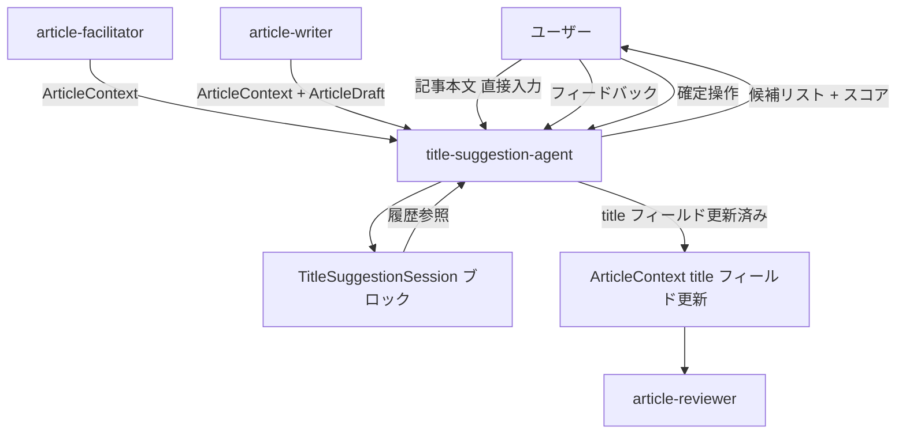
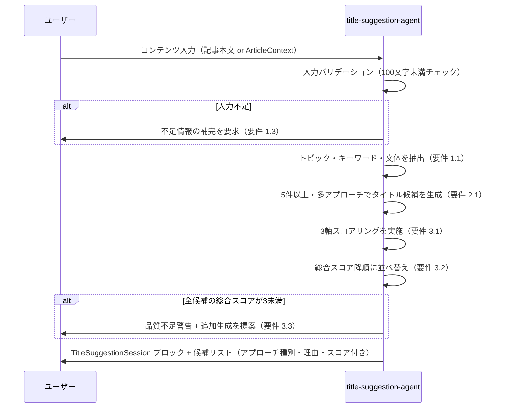
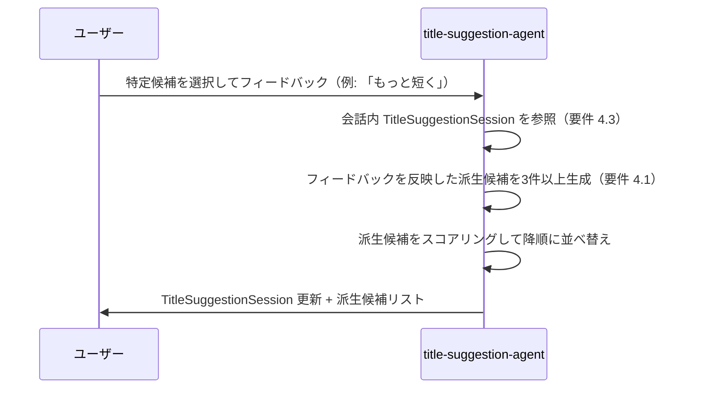
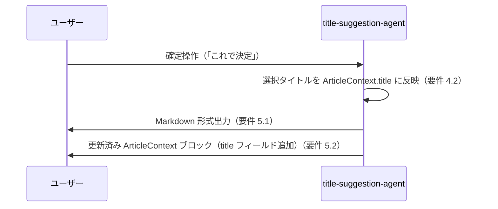

# 設計ドキュメント: title-suggestion-agent

## Overview

title-suggestion-agent は記事・文書のコンテンツを入力として受け取り、複数のタイトル候補を評価・スコアリングして提示する Claude Code Skill である。ユーザーのフィードバックを反映した反復改善をサポートし、確定タイトルを ArticleContext に書き戻すことで article-writer・article-editor などの後続スキルと連携する。

**Purpose**: article-writer が生成する3本のタイトル案では物足りない場合や、タイトル作成を専任で深堀りしたい場面で、5件以上の多角的な候補とスコアリングを提供することで、根拠のある最終タイトル選択を支援する。

**Users**: ノウハウ解説記事を制作するコンテンツ作成者が、会話型インターフェースを通じてタイトル候補の生成・評価・絞り込みを行う。

**Impact**: 既存の article-agent パイプラインに新スキルとして追加されるが、必須フローではなくオプショナルに位置付けられる。ArticleContext に `title` フィールドを追加するスキーマ拡張を伴う。

### Goals

- 5件以上・多アプローチのタイトル候補を一度に提示する（要件 2.1〜2.4）
- 3軸スコアリングで候補を客観的に比較できるようにする（要件 3.1〜3.3）
- 反復フィードバックで最適なタイトルへ収束させる（要件 4.1〜4.3）
- 確定タイトルを ArticleContext に反映し後続スキルへ引き継ぐ（要件 5.1〜5.4）

### Non-Goals

- 外部 SEO ツール・見出し分析 API の利用
- article-writer・article-reviewer の代替または統合
- 画像生成プロンプトへのタイトル適用（article-thumbnail の責務）
- 多言語タイトルの同時生成（要件 5.3 は単一指定言語のみ）

---

## Requirements Traceability

| 要件 | 概要 | 担当コンポーネント | インターフェース | フロー |
|------|------|------------------|----------------|------|
| 1.1–1.4 | コンテンツ入力と解析 | title-suggestion-agent | TitleSuggestionService.suggestTitles | フロー F1 |
| 2.1–2.4 | タイトル候補の生成 | title-suggestion-agent | TitleSuggestionService.suggestTitles | フロー F1 |
| 3.1–3.3 | 提案の評価・スコアリング | title-suggestion-agent | TitleSuggestionService.suggestTitles | フロー F1 |
| 4.1–4.3 | ユーザーフィードバックへの対応 | title-suggestion-agent | TitleSuggestionService.refineTitles | フロー F2 |
| 5.1–5.4 | 出力フォーマットと統合 | title-suggestion-agent | TitleSuggestionService.confirmTitle | フロー F3 |

---

## Architecture

### Architecture Pattern & Boundary Map

採択パターン: **独立スキル（Optional Stage）**（詳細は `research.md` の Architecture Pattern Evaluation 参照）

- 既存パイプライン（article-facilitator → article-writer → article-reviewer → article-thumbnail）に対してオプショナルに挿入可能
- article-facilitator 出力後または article-writer 出力後のどちらでも起動できる
- 他スキルと同じく ArticleContext を会話内 Markdown ブロックとして参照・更新する



**アーキテクチャ統合:**

- 選択パターン: 独立スキル — 既存スキルへの変更ゼロで追加可能
- 境界: title-suggestion-agent は ArticleContext と ArticleDraft を読み込み専用で参照し、title フィールドのみ更新して返す
- 既存パターン: Claude Code Skills（SKILL.md）の標準慣行に準拠
- スキーマ拡張: ArticleContext に `title?: string` をオプション追加（後方互換）

### Technology Stack

| レイヤー | 選択 / バージョン | 役割 | 備考 |
|---------|----------------|------|------|
| スキル定義 | Claude Code Skills（SKILL.md） | エージェント役割の定義と指示 | `.claude/skills/title-suggestion-agent/` |
| 状態共有 | Markdown ブロック（会話埋め込み） | TitleSuggestionSession / ArticleContext の受け渡し | 既存パイプラインと同方式 |
| スコアリング | LLM 内部評価 | 3軸スコアの算出 | 外部 API 依存なし |
| 出力形式 | Markdown + ArticleContext ブロック | 候補リストと統合コンテキストの提示 | 既存パイプラインと互換 |

---

## System Flows

### F1: タイトル生成フロー



### F2: フィードバック反復フロー



### F3: タイトル確定フロー



**フロー上の重要判断:**

- F1 でコンテキスト不足の場合は即座に案内して処理を停止する（要件 1.3）
- F2 の派生候補も F1 と同じスコアリングを経て出力される
- F3 で ArticleContext が渡されていない場合は Markdown のみを返し ArticleContext 更新はスキップする

---

## Components and Interfaces

### コンポーネント一覧

| コンポーネント | ドメイン / レイヤー | 意図 | 要件カバレッジ | 主要依存 | コントラクト |
|-------------|-----------------|------|--------------|---------|------------|
| title-suggestion-agent | タイトル生成レイヤー | コンテンツを解析してスコア付きタイトル候補を生成・反復改善し確定結果を ArticleContext に反映する | 1.1–5.4 | 会話コンテキスト（P0）, ArticleContext（P1） | Service, State |

---

### タイトル生成レイヤー

#### title-suggestion-agent

| フィールド | 詳細 |
|----------|------|
| Intent | コンテンツ入力を解析し、多アプローチ・スコアリング付きタイトル候補を生成する。フィードバック反復と確定操作をサポートし、最終タイトルを ArticleContext に書き戻す |
| Requirements | 1.1, 1.2, 1.3, 1.4, 2.1, 2.2, 2.3, 2.4, 3.1, 3.2, 3.3, 4.1, 4.2, 4.3, 5.1, 5.2, 5.3, 5.4 |

**Responsibilities & Constraints**

- 入力が 100 文字未満の場合は補完を求め、タイトル生成を開始しない（要件 1.3）
- ArticleContext を入力フォーマットとしてサポートし、既存フィールドを保持する（要件 1.4、5.2）
- 各候補は 40 文字以内（日本語）に収める。超過する場合は短縮候補を自動提示する（要件 2.4）
- スコアは参考指標であり最終判断はユーザーに委ねることを明示する（research.md: リスク参照）
- title フィールドのみを更新し、ArticleContext の他フィールドを変更しない（要件 5.2）
- セッション履歴を会話内 TitleSuggestionSession ブロックとして都度出力する（要件 4.3）

**Dependencies**

- Inbound: ユーザー入力（記事本文 / ArticleContext / フィードバック） — 会話コンテキスト（P0）
- Inbound: ArticleContext Markdown ブロック — article-facilitator 出力（P1）
- Outbound: 更新済み ArticleContext ブロック（title フィールド追加） — article-writer 以降のスキル（P1）

**Contracts**: Service [x] / State [x]

##### Service Interface

```typescript
interface TitleSuggestionService {
  /**
   * コンテンツを解析し、スコアリング付きタイトル候補を5件以上生成する。
   * 入力不足の場合は guidanceMessage を設定し、candidates を空配列で返す。
   */
  suggestTitles(input: TitleSuggestionInput): TitleSuggestionOutput;

  /**
   * 指定候補に対するフィードバックを反映した派生候補を3件以上生成する。
   */
  refineTitles(
    session: TitleSuggestionSession,
    request: TitleRefinementRequest
  ): TitleSuggestionOutput;

  /**
   * 選択されたタイトルを確定し、ArticleContext.title を更新して返す。
   * articleContext が null の場合は Markdown 出力のみを返す。
   */
  confirmTitle(
    session: TitleSuggestionSession,
    selectedTitle: string,
    articleContext: ArticleContext | null
  ): TitleConfirmationOutput;
}
```

- Preconditions: `suggestTitles` — 入力テキストが 100 文字以上、または有効な ArticleContext が存在する
- Postconditions: `suggestTitles` / `refineTitles` — `candidates` に 1 件以上の TitleCandidate が含まれる（入力不足の場合を除く）
- Invariants: `confirmTitle` は ArticleContext の `title` 以外のフィールドを変更しない

##### State Management

- State model: `TitleSuggestionSession`（round 1 → round N → confirmed）
- Persistence: 会話内に `## TitleSuggestionSession` Markdown ブロックを出力することで暗黙的に永続化
- Concurrency strategy: 単一会話セッション内での逐次処理のみ

**Implementation Notes**

- Integration: SKILL.md の `description` に「サムネイルを作って」「サムネイル用のプロンプトを生成して」ではなく「タイトルを提案して」「タイトル候補がほしい」「見出しを考えて」などのトリガーキーワードを明記する
- Validation: 起動宣言「タイトル候補の生成を開始します」を最初に出力し、入力コンテンツの確認結果を示す
- Risks: LLM スコアリングの主観性 → ユーザーへの「参考指標」明示と、最終判断はユーザーに委ねる旨を SKILL.md に明記する

---

## Data Models

### Domain Model

- **TitleSuggestionSession**（集約ルート）: タイトル提案セッションの全状態を保持。会話内 Markdown ブロックとして永続化
- **TitleCandidate**（エンティティ）: タイトル文字列・アプローチ種別・選定理由・スコアを持つ候補単位
- **TitleScores**（値オブジェクト）: 3軸スコアと総合スコアを保持
- **ArticleContext**（集約ルート、拡張）: 既存スキーマに `title?: string` を追加。title-suggestion-agent のみが title フィールドを更新する

不変条件:

- `TitleSuggestionSession.selectedTitle` が設定されるのは `confirmTitle` 呼び出し後のみ
- `confirmTitle` は ArticleContext の `title` 以外のフィールドを変更しない

### Logical Data Model

```typescript
// --- 既存スキーマへの拡張（後方互換）---
interface ArticleContext {
  theme: string;
  targetAudience: string;
  purpose: string;
  keyMessages: string[];
  primaryExperiences: string[];
  style: ArticleStyle;
  outline: ArticleOutline;
  confirmedAt: string | null;
  title?: string;  // 追加: title-suggestion-agent が確定時に設定する
}

// --- title-suggestion-agent 固有型 ---

type TitleApproachType =
  | 'question'    // 問いかけ型
  | 'statement'   // 断言型
  | 'howto'       // ノウハウ型
  | 'number'      // 数字型
  | 'catchcopy'   // キャッチコピー型
  | 'other';

type TitleStyle = 'seo' | 'catchcopy' | 'question' | 'howto' | 'number' | 'statement';

interface TitleSuggestionInput {
  content: string | null;                // 記事本文テキスト
  articleContext: ArticleContext | null; // ArticleContext（優先参照）
  targetAudience?: string;
  medium?: string;
  tone?: string;
  preferredStyle?: TitleStyle;           // スタイル指定（要件 2.3）
}

interface TitleScores {
  clickAttraction: 1 | 2 | 3 | 4 | 5;     // クリック誘引度
  clarity: 1 | 2 | 3 | 4 | 5;             // 明瞭さ
  contentAlignment: 1 | 2 | 3 | 4 | 5;    // コンテンツ整合性
  total: number;                            // 3–15
}

interface TitleCandidate {
  title: string;                   // 40文字以内（日本語）
  approachType: TitleApproachType;
  reason: string;                  // 選定理由（1〜2文）
  scores: TitleScores;
}

interface TitleSuggestionSession {
  rounds: TitleCandidate[][];   // ラウンドごとの候補履歴（rounds[0] = 初回）
  currentRound: number;
  selectedTitle: string | null;
}

interface TitleSuggestionOutput {
  candidates: TitleCandidate[];    // 総合スコア降順
  guidanceMessage?: string;        // 入力不足 or 品質不足の場合のみ設定
  updatedSession: TitleSuggestionSession;
}

interface TitleRefinementRequest {
  basedOnTitle: string;  // 派生元タイトル
  feedback: string;      // 「もっと短く」「疑問形にして」など
}

interface TitleConfirmationOutput {
  selectedTitle: string;
  markdownSummary: string;                  // Markdown 形式出力（要件 5.1）
  updatedArticleContext: ArticleContext | null;  // ArticleContext が渡された場合のみ
}
```

### Data Contracts & Integration

**TitleSuggestionSession Markdown ブロック（会話内状態フォーマット）**

title-suggestion-agent は以下の形式でセッション状態を会話に出力する。フィードバック反復時に参照する。

```markdown
## TitleSuggestionSession

- **ラウンド**: [N]
- **確定タイトル**: [タイトル or 未確定]

### ラウンド [N] 候補

| # | タイトル | アプローチ | クリック | 明瞭さ | 整合性 | 合計 |
|---|---------|---------|--------|------|------|-----|
| 1 | [タイトル] | [種別] | [1-5] | [1-5] | [1-5] | [3-15] |
```

**更新済み ArticleContext ブロック（確定時出力フォーマット）**

確定操作後、ArticleContext が存在する場合は以下の差分を加えて出力する。

```markdown
## ArticleContext

- **テーマ**: [既存]
...（既存フィールドをすべて保持）...
- **タイトル（確定）**: [選択されたタイトル]  ← 追加フィールド
- **確認日時**: [ISO 8601]
```

---

## Error Handling

### Error Strategy

- **Fail Fast**: 入力バリデーションをフロー開始時に実施し、不足の場合は即座に案内して処理を停止する
- **Graceful Degradation**: 全候補がスコア3未満の場合は警告を出すが、候補リストは返却する
- **User Context**: エラーメッセージは「何が不足しているか」と「次に何をすべきか」を明示する

### Error Categories and Responses

**ユーザーエラー（入力不足）**

| 状況 | 検出 | 対応 |
|------|------|------|
| 入力テキストが 100 文字未満 | バリデーション | 「記事本文が不足しています。本文または ArticleContext を提供してください」と案内して処理を停止（要件 1.3） |
| ArticleContext も本文も未提供 | バリデーション | 同上 |

**ビジネスロジックエラー（品質）**

| 状況 | 対応 |
|------|------|
| 全候補の総合スコアが 3 未満 | 品質不足の旨を警告し、追加生成または入力補完を提案（要件 3.3） |
| タイトルが 40 文字超過 | 短縮候補を自動付記して提示（要件 2.4） |

### Monitoring

- 各ラウンドの TitleSuggestionSession ブロックを会話に出力することで状態変化を観察可能

---

## Testing Strategy

### Unit Tests（スキル単体テスト）

各スキル動作確認として `examples/` にサンプル入出力ペアを用意する。

1. 記事本文のみ入力 → 5件以上・アプローチ種別付きの候補リストが返ることを確認（要件 2.1–2.2）
2. 100 文字未満の入力 → 補完要求メッセージが返り処理が停止することを確認（要件 1.3）
3. ArticleContext 入力 → theme / targetAudience / tone が候補に反映されることを確認（要件 1.1–1.4）
4. スタイル指定「SEO重視」 → 3件以上の SEO 特化候補が追加されることを確認（要件 2.3）
5. 全候補スコア 3 未満 → 品質警告メッセージが出力されることを確認（要件 3.3）
6. フィードバック「もっと短く」 → 3件以上の派生候補が生成されることを確認（要件 4.1）
7. 確定操作 → ArticleContext の title フィールドのみ更新されることを確認（要件 4.2、5.2）

### Integration Tests（パイプライン統合テスト）

1. article-facilitator → title-suggestion-agent: ArticleContext を受け取り候補を生成し確定、更新済み ArticleContext を article-writer に引き継ぐ
2. article-writer → title-suggestion-agent: ArticleDraft の titleCandidates を起点に追加候補を生成する
3. フィードバック反復フロー: 2ラウンド以上のフィードバックループ後に確定し、全ラウンドの履歴が TitleSuggestionSession に保持されていることを確認

### E2E Tests（シナリオ）

`examples/` の既存シナリオに以下を追加する。

1. シナリオ E: article-facilitator → title-suggestion-agent → article-writer（フルパイプライン、タイトル確定ルート）
2. シナリオ F: 記事本文のみからタイトルを生成し、フィードバック1回を経て確定する最短フロー

---

## Security Considerations

- `.env` ファイルや個人情報はスキルが読み取らず出力にも含めない（既存パイプラインと共通）
- ArticleContext の `title` 以外のフィールドへの書き込みを SKILL.md に禁止として明記する（越権防止）

## Supporting References

詳細な調査ログ・アーキテクチャパターン比較・設計判断の根拠は [research.md](./research.md) を参照。
